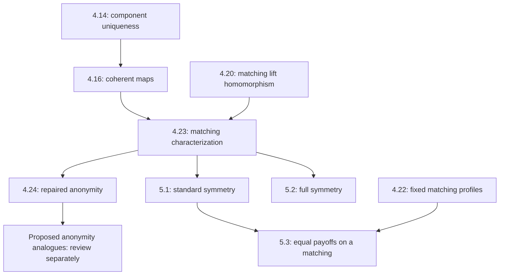

# Dependency graph and review-impact policy

Canonical data: [dependencies.json](dependencies.json). An edge points from prerequisite to dependent and means that a change requires review. Mathematical dependency, source citation and interpretation dependency are distinguished. Original explicit source references are retained separately from the corrected proof graph. This is not an automatic theorem prover.



No dependency from 4.24 to 5.1–5.3 is inferred merely because the statements occur later in the source. Their conjugation proofs stand without it. The 4.19 typing ambiguity is repaired by explicit player objects; downstream coherence is checked directly.

```sh
python3 scripts/audit.py check
python3 scripts/audit.py impact 4.24
python3 scripts/audit.py impact 4.23
python3 scripts/audit.py impact 2.2:strict-nonsurjectivity
```

When finding an error: preserve the pinned original; update its separate source verdict/corrected status in audit.json; add the counterexample and proof record; run the impact command and reconsider every returned descendant. Add a missing edge if a new dependency is found. Run render to regenerate the audit table. No script silently edits mathematical statuses. Source integrity checks are tamper evidence, not external authentication or write-once storage.
